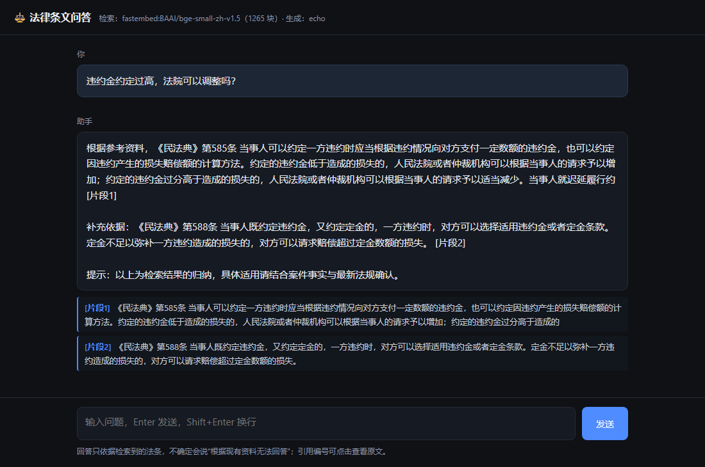

# LegalKB-Agent

面向法律条文的 RAG 问答服务：**混合检索 + 重排 + 引用溯源 + 可复现评测**。
不依赖任何 LLM API 也能跑起来（内置离线桩），配置后可直接接 OpenAI 兼容模型。

> 语料：《民法典》1260 条（`data/law.txt`）。所有代码可离线运行，评测一条命令出报告。



<sub>界面：输入问题 → 流式作答 → 下方列出引用，点开可见原文（图为离线桩模式输出；接真实模型后为自然语言作答）。</sub>

---

## 它解决什么问题

法律问答的三个真实难点，不是"接个模型"能解决的：

1. **术语精确匹配**："违约金" vs "赔偿金" 语义近但适用不同条款 → 需要 BM25 兜底；
2. **上下文不能碎**：一个法条被切成两半，模型只看到"条件"或只看到"后果" → 父子切块；
3. **必须可溯源**：律师/法务不会相信没有出处的回答 → 强制 `[片段n]` 引用 + 编号合法性校验。

## 架构

```
law.txt ─▶ 清洗 ─▶ 父子切块 ─┬─▶ 向量索引（numpy / FAISS 可选）
                             └─▶ BM25 倒排
question ─▶ vector top-10 ┐
           bm25   top-10 ├─▶ 加权 RRF ─▶ 重排 top-5 ─▶ prompt ─▶ LLM
                         ┘                                      │
                       引用解析 [片段n] ◀── 回答 ────────────────┘
```

细节见 [`docs/architecture.md`](docs/architecture.md)，取舍见 [`docs/design-decisions.md`](docs/design-decisions.md)。

## 快速开始

**Windows 上最简单**：双击 `启动.bat`，浏览器会自动打开 `http://127.0.0.1:8000`——
那是一个聊天页（输入问题 → 流式回答 → 引用可看原文），不是 Swagger。

命令行三步：

```bash
pip install -r requirements.txt
python -m scripts.build_index          # 建索引（约 0.4s，1265 个子块）
python -m scripts.explain "违约金约定过高，法院可以调整吗"   # 逐步打印整条链路
python -m scripts.ask "违约金约定过高，法院可以调整吗"
```

起服务：

```bash
uvicorn app.main:app --reload --port 8000
# 浏览器打开 http://127.0.0.1:8000        ← 聊天页
# 接口文档      http://127.0.0.1:8000/docs  ← 调试用
# 或
docker compose up --build
```

```bash
curl -X POST http://127.0.0.1:8000/api/chat \
  -H "Content-Type: application/json" \
  -d '{"question":"结婚年龄是多少？"}'
```

流式（SSE）：`POST /api/chat/stream`，事件为 `delta` → `citations` → `done`。

## 在线模式（真实模型）

默认配置是离线的（`hash` 向量 + `echo` 桩），**故意如此**：让任何人 clone 下来就能跑、CI 不依赖付费 API。
要跑真实效果，两条路：

**A. 调用 API（不需要 GPU，最快）**

```bash
# .env 里：
#   EMBEDDING_PROVIDER=api
#   EMBEDDING_DIM=1024
#   EMBEDDING_MODEL=text-embedding-v3
#   LLM_PROVIDER=dashscope
#   LLM_MODEL=qwen-plus
#   DASHSCOPE_API_KEY=sk-xxx

rm -rf data/index && python -m eval.run --all      # 用真实语义向量重建并评测
```

**B. 本地 bge（需要 torch，约 2GB）**

```bash
pip install torch --index-url https://download.pytorch.org/whl/cpu
pip install sentence-transformers
# .env 里 EMBEDDING_PROVIDER=bge，然后 rm -rf data/index
```

两种方式都改完后，`data/index/meta.json` 里的 `embedder` 会变，
加载时若与当前配置不一致会**直接报错**而不是静默返回垃圾结果。

## 评测

```bash
python -m eval.run --all        # 四种检索策略横向对比，输出 results/
```

**A. 真实语义向量（bge-small-zh-v1.5，ONNX/CPU，无需 GPU）**
配置：`CHILD_SIZE=150`、权重 `0.8 / 0.2`（依据见下方「参数实验」）

| 策略 | Recall@3 | Recall@5 | MRR | 引用编号合法率 | 检索延迟 |
| :--- | ---: | ---: | ---: | ---: | ---: |
| **vector（纯向量）** | **100%** | **100%** | **0.958** | 100% | 6 ms |
| bm25（纯关键词） | 83.3% | 91.7% | 0.757 | 100% | 18 ms |
| hybrid（加权 RRF） | 100% | 100% | 0.944 | 100% | 32 ms |
| hybrid_rerank（+词面重排） | 100% | 100% | 0.944 | 100% | 33 ms |

**B. 离线基线（hash-512-idf 向量，用于 CI 与无模型环境）**

| 策略 | Recall@3 | Recall@5 | MRR |
| :--- | ---: | ---: | ---: |
| vector | 66.7% | 75.0% | 0.595 |
| bm25 | 83.3% | 91.7% | 0.674 |
| hybrid | 75.0% | 91.7% | 0.653 |
| hybrid_rerank | 75.0% | 91.7% | 0.681 |

**怎么读这两张表**（结论比数字重要）：

1. **同一套代码、同一套题，换掉 embedding 后排名完全反转**：哈希向量下 BM25 最强，真语义向量下纯向量 100%。这说明"哪个策略更好"**不可脱离 embedding 讨论**——不写清楚模型版本的评测表没有意义。
2. **16 题已经被打满（100%）**，指标失去区分度。下一步必须扩到 50–100 题，并加入"同义改写""需要跨条推理"的难题，否则无法衡量优化是否真的有效。
3. **加模块不等于变好**：词面重排（overlap）叠在语义检索上会让 Recall@3 从 100% 掉到 83.3%——它是字面启发式，会把"语义对但用词不同"的结果压下去。所以默认配置里重排是关闭的；要用就换成 cross-encoder（bge-reranker），而不是这种技巧。
4. **BM25 在两次实验里都稳定在 83.3%**：条号、专有名词这类精确匹配，语义向量替代不了。混合检索的价值在长尾兜底，不在平均分。
5. 生成侧（引用准确率、拒答率）需要真实 LLM；当前 LLM 账户不可用，报告里标 `N/A`，不编数。

**C. 真实生成链路（bge 检索 + qwen3.8-omni-flash 生成，16 题）**

| 策略 | Recall@3 | Recall@5 | MRR | 引用准确率 | 答案含证据率 | 拒答精确率/召回率 | 延迟 |
| :--- | ---: | ---: | ---: | ---: | ---: | ---: | ---: |
| **vector** | **100%** | **100%** | **0.903** | **100%** | **91.7%** | **100% / 100%** | 23.0 s |
| bm25 | 83.3% | 91.7% | 0.674 | 91.7% | 75.0% | 100% / 100% | 29.0 s |
| hybrid | 91.7% | 100% | 0.882 | 100% | 83.3% | 100% / 100% | 29.0 s |
| hybrid_rerank | 91.7% | 100% | 0.882 | 100% | 83.3% | 100% / 100% | 28.6 s |

> 最后两行数值相同是**故意的**：当前 `RERANKER=none`（词面重排被证明有害），
> 所以 `hybrid_rerank` 退化为 `hybrid`。这不是凑数，是把"关掉重排"这个决定如实呈现。

**这三张表合起来说明什么**：

1. **引用是可信的**：引用准确率 100%（vector/hybrid）意味着模型给出的每个 `[片段n]` 都确实包含标准答案证据；编号合法率 100% 说明越界引用被拦住了。
2. **拒答是真的**：4 道语料外题目（公司法、加州离婚、醉驾、加班费）**全部拒答**，精确率和召回率都是 100%，没有靠"什么都说不会"来刷分。
3. **检索质量直接决定答案质量**：bm25 → vector，引用准确率从 91.7% 升到 100%，答案含证据率从 75% 升到 91.7%。
4. **延迟是最大短板**：23–29 秒。这是免费额度模型的真实速度，不是评测脚本的锅。生产化必须做：`TOP_N` 调小、查询缓存、简单问题路由到小模型。
5. **16 题已经饱和**（vector 100%），指标失去区分度 → 下一步扩到 50–100 题并加难题。

指标定义与"为什么用锚点不用 chunk id"见 [`eval/metrics.py`](eval/metrics.py) 头部注释。

## 复现这两张表

```bash
# A. 真语义向量（首次会下载 ~95MB ONNX 模型到 .models/）
EMBEDDING_PROVIDER=fastembed EMBEDDING_MODEL=BAAI/bge-small-zh-v1.5 \
EMBEDDING_PATH=.models/bge-small-zh RERANKER=overlap \
python -m eval.run --all --llm echo --out-dir results/onnx

# B. 离线基线
EMBEDDING_PROVIDER=hash RERANKER=overlap \
python -m eval.run --all --llm echo --out-dir results/offline
```

## 参数实验（单变量对照，可复现）

用 `scripts.compare` 横向对比多个实验目录。以下三组都在同一套题、同一 embedding 下完成，**每次只改一个变量**。

**① 切块粒度**（`CHILD_SIZE` 80 / 150 / 300）

| CHILD_SIZE | 块数 | vector MRR | bm25 MRR | bm25 延迟 |
| ---: | ---: | ---: | ---: | ---: |
| 80 | 2835 | 0.917 | 0.701 | 38 ms |
| **150** | ~1700 | **0.958** | **0.757** | 18 ms |
| 300 | 1265 | 0.903 | 0.674 | 17 ms |

Recall@3 三点均为 100%（金标是条文级锚点，对切块不敏感），但 MRR 呈**倒 U 型**：150 是甜区，块太碎会切断上下文、块数翻倍还让延迟翻倍。

**② 融合权重**（`WEIGHT_VECTOR : WEIGHT_BM25`）

| 权重比 | hybrid R@3 | hybrid MRR |
| ---: | ---: | ---: |
| 1 : 1 | 91.7% | 0.938 |
| 1.6 : 1 | 100% | 0.944 |
| 2 : 1 | 100% | 0.944 |
| **1 : 0** | 100% | **0.958**（= 纯向量） |

结论：**RRF 的权重是比例、不做归一化**；弱路即使权重很小，它排第 1 的条目仍能拿分，所以“融合”压不干净噪声——把权重归零后，hybrid 与纯向量完全一致，说明这套数据上融合没有增益。

**③ 反例：不能因此说 BM25 无用。** 16 道题里没有“按法条号查询”的题，BM25 的强项（精确匹配编号/专名）根本没被测到。这是**评测集覆盖问题**，不是 BM25 的问题——也是下一步要把金标集扩到 50 题的原因。

## 目录结构

```
app/            FastAPI 接入层 + 服务编排
├─ main.py         路由 / SSE / 鉴权
├─ core/           配置、结构化日志
└─ services/       索引生命周期、运行指标
rag/            核心 RAG（不依赖 app，可单独测）
├─ ingest/         清洗、父子切块
├─ index/          BM25、向量、持久化、embedding 适配
├─ retrieve/       RRF 融合、三种重排
├─ generate/       prompt、LLM 适配、引用解析
└─ pipeline.py     检索→重排→生成→引用
eval/           金标集 + 指标 + 一条命令出报告
tests/          25 个用例（切块/BM25/RRF/引用/端到端/API；API 用例需 httpx）
docs/           架构、ADR
```

## 已知局限

1. **只有《民法典》**：刑法、劳动法、公司法不在语料里，跨法域问题会误答（评测集里 4 道无据题就是为了量化这个问题）。
2. **拒答只能靠 prompt**：没有独立的"相关性判别"模型，域外问题（如"美国加州离婚"）因为词汇都在语料里，检索会命中，模型也就不会拒答。
3. **父子切块在本语料退化为 1:1**（单条平均 86.6 字），对长文档才有收益。
4. **单机索引**：numpy 精确检索，适合 <10 万块；再往上要换 FAISS/Qdrant。
5. **无会话记忆**：每次请求独立，多轮指代（"那它呢？"）不支持。

## Roadmap

- [ ] 接 bge-small-zh + bge-reranker，补真实模型下的评测表
- [ ] 语义拒答：用 LLM 判断"检索结果能否回答问题"，量化误拒率
- [ ] LangGraph 编排：路由（问答 / 计算 / 拒答）→ 检索 → 校验
- [ ] 会话持久化 + 前端引用高亮（Vue3）
- [ ] 金标集扩到 100 题，加 LLM-as-judge 与人工抽检一致性

## 开发

```bash
pip install -r requirements-dev.txt
pytest -q
ruff check .
```
